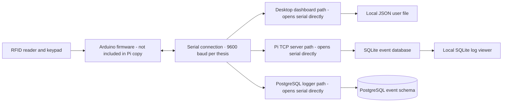

# Current-State Assessment

**Status:** Draft based on the supplied Pi folder; validate assumptions before treating them as stakeholder-approved requirements.

## Executive summary

The thesis describes one intended architecture: an Arduino Nano 33 IoT handles RFID/keypad/tamper inputs and physical feedback; a Raspberry Pi Zero 2 W handles access decisions, SQLite event logging, serial recovery, and a Tkinter admin interface. The supplied Pi folder contains several versions and alternative data paths, not one clearly identified integrated application. In the supplied code snapshot, the dashboard, TCP server variants, and PostgreSQL serial logger each open the serial device directly. They also represent different user and event-storage approaches. The relationship between the thesis design and the exact code used in the demonstration needs to be confirmed.

The immediate analysis recommendation is to document one operating scenario and select one system of record before consolidating code. Do not combine the variants by simply running them together.

## System context

The intended business flow is to read an access credential, evaluate the submitted factors, give the person a clear allow/deny outcome, and make the event available to an administrator. The thesis architecture identifies an RC522 reader, ZRX543 keypad, endstop tamper switch, 9600-baud serial link, SQLite store, Tkinter dashboard, LCD, RGB LED, and buzzer. The firmware source is not present in this Pi folder; the available Python test script is only a serial message sender. See the [thesis foundation and system walkthrough](THESIS_FOUNDATION.md) for the design-vs-code boundary.

The diagram below shows alternative paths found in the supplied Pi folder. It does not reproduce the thesis's intended runtime and does not imply that these alternatives were deployed together. Sharing a physical serial port between them would need an explicit connection owner or broker.

## Component inventory

| Component | Observed responsibility | Current-state concern |
|---|---|---|
| Desktop dashboard | Admin login, status/log screens, user management, direct serial connection, local JSON user storage | Duplicate copies exist; it does not appear to use the Pi server or PostgreSQL logger interface |
| Minimal TCP server | Relays network-client messages to the serial device | No user store or event database |
| SQLite server variants | Add event logging; later variant adds a separate network log port and auth flow | Bind to all interfaces; the legacy network protocol has no server-side client authentication or encryption |
| PostgreSQL serial logger | Reads serial messages and records access/security events | Owns the serial connection too; it writes event data but is not the dashboard's user-management service |
| SQLite database and viewer | Stores access logs and displays recent rows locally | Database contains historical demo activity; keep it and its journal out of public GitHub |
| PostgreSQL schema | Defines users, devices, access logs, and security events with keys and constraints | A different persistence path from the SQLite server variants; needs to be mapped to actual workflows |
| Python serial test sender | Sends test messages over a fixed serial connection | Hardware-specific test utility, not a repeatable demo without the device |
| Local virtual environment | Captures a machine-specific Python installation | Rebuild from a dependency manifest; do not publish the environment directory |

## Data and process observations

- **User data has multiple possible owners:** the dashboard and auth-server variants use a local JSON file, while the PostgreSQL schema defines a relational users table. The supplied PostgreSQL logger appears focused on event logging rather than user administration.
- **Event data has multiple possible stores:** the older server versions write SQLite events; the serial logger writes PostgreSQL events. The included SQLite viewer reads only the local SQLite database.
- **Credential material may enter event messages:** older serial/server paths preserve raw messages in logs. Before selecting a public demonstration flow, define which fields may be recorded and ensure secret factors never appear in event detail.
- **The current UI/server boundary is unclear:** the dashboard reads serial directly, while the Pi server also reads serial. A target design should assign one component ownership of that connection.
- **Network exposure needs a deliberate design:** the legacy TCP server variants listen on all interfaces and do not authenticate clients or encrypt their protocol. They should remain disabled in a public-facing or shared-network demo until replaced or protected.
- **Configuration is inconsistent:** serial paths, ports, user data, and database choices are embedded in different programs. The future-state design should document per-environment configuration and safe defaults.

## Questions to resolve during discovery

1. Is the intended deployment a single local door, or should an administrator connect from another computer?
2. Which person or role is allowed to add, deactivate, and review users?
3. Must access continue if the database or network is unavailable? What should the device do in each failure case?
4. What event details are operationally necessary, and how long should each be retained?
5. Is RFID plus PIN required for every user, or are there approved alternate authentication paths?
6. Is the original Arduino firmware available elsewhere, or should the portfolio demo use a documented simulator?
7. Is PostgreSQL the intended future database, or should the project remain a single-device local system?

## Initial analyst recommendation

Compare two future-state options before implementation:

- **Local-first:** one Pi application owns the serial port, uses one local database, and provides an administrator interface on the same machine. This minimizes network and deployment complexity.
- **Service-and-dashboard:** one Pi service owns the serial port and database connection; a separately authenticated dashboard accesses it through a documented API. This better supports remote administration but adds deployment, authentication, and network-security work.

Choose only after documenting user needs, failure behavior, data-retention expectations, and operational constraints. Use synthetic data for all public screenshots and demonstrations.
