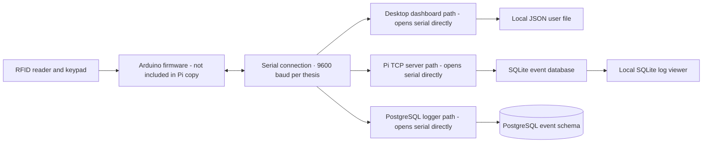

# Current-State Assessment

**Status:** Portfolio analysis based on the supplied Pi folder. The findings are not stakeholder-approved requirements.

## Executive summary

The thesis describes one intended architecture: an Arduino Nano 33 IoT handles RFID/keypad/tamper inputs and physical feedback; a Raspberry Pi Zero 2 W handles access decisions, SQLite event logging, serial recovery, and a Tkinter admin interface. The supplied Pi folder contains several versions and alternative data paths, not one clearly identified integrated application. In the supplied code snapshot, the dashboard, TCP server variants, and PostgreSQL serial logger each open the serial device directly. They also represent different user and event-storage approaches. The supplied code snapshot does not identify which variant powered the thesis demonstration.

The code review identifies an integration decision: define one operating scenario and one system of record before consolidating code. The variants are separate paths; running them together creates competing serial connections.

## System context

The intended business flow is to read an access credential, evaluate the submitted factors, give the person a clear allow/deny outcome, and make the event available to an administrator. The thesis architecture identifies an RC522 reader, ZRX543 keypad, endstop tamper switch, 9600-baud serial link, SQLite store, Tkinter dashboard, LCD, RGB LED, and buzzer. The firmware source is not present in this Pi folder; the available Python test script is only a serial message sender. See the [thesis foundation and system walkthrough](THESIS_FOUNDATION.md) for the design-vs-code boundary.

The diagram below shows alternative paths found in the supplied Pi folder. It does not reproduce the thesis's intended runtime and does not imply that these alternatives were deployed together. Sharing a physical serial port between them would need an explicit connection owner or broker.

## Component inventory

| Component | Observed responsibility | Current-state concern |
|---|---|---|
| Desktop dashboard | Admin login, status/log screens, user management, direct serial connection, local JSON user storage | Duplicate copies exist; it does not appear to use the Pi server or PostgreSQL logger interface |
| Minimal TCP server | Relays network-client messages to the serial device | No user store or event database |
| SQLite server variants | Add event logging; later variant adds a separate network log port and auth flow | Bind to all interfaces; the legacy network protocol has no server-side client authentication or encryption |
| PostgreSQL serial logger | Reads serial messages and records access/security events | Owns the serial connection too; it writes event data but is not the dashboard's user-management service |
| SQLite database and viewer | Stores access logs and displays recent rows locally | Database contains historical demo activity; keep it and its journal out of public GitHub |
| PostgreSQL schema | Defines users, devices, access logs, and security events with keys and constraints | A different persistence path from the SQLite server variants; needs to be mapped to actual workflows |
| Python serial test sender | Sends test messages over a fixed serial connection | Hardware-specific test utility, not a repeatable demo without the device |
| Local virtual environment | Captures a machine-specific Python installation | Rebuild from a dependency manifest; do not publish the environment directory |

## Data and process observations

- **User data is defined in multiple places:** the dashboard and auth-server variants use a local JSON file, while the PostgreSQL schema defines a relational users table. The supplied PostgreSQL logger records events and does not administer users.
- **Event data is stored through separate paths:** the older server versions write SQLite events; the serial logger writes PostgreSQL events. The included SQLite viewer reads only the local SQLite database.
- **Credential exposure in logs:** older serial/server paths preserve raw messages in logs. The public demonstration excludes raw messages and secret factors.
- **UI/server boundary:** the dashboard and Pi server each open serial directly. The reviewed snapshot contains no shared connection broker.
- **Network security:** the legacy TCP server variants listen on all interfaces without client authentication or protocol encryption. Their network exposure is unsafe for public or shared networks.
- **Configuration:** serial paths, ports, user data, and database choices are embedded in separate programs and differ across variants.

## Open design decisions

1. Deployment scope: one local door or administrator access from another computer.
2. Administrator roles for adding, deactivating, and reviewing users.
3. Access behavior during database or network outages.
4. Required event details and retention period.
5. Required authentication factors and approved alternate paths.
6. Location of the Arduino firmware; the supplied Pi copy does not include it.
7. Authoritative database and local-versus-networked deployment model.

## Architecture options identified in the review

Two future-state options identified in the review:

- **Local-first:** one Pi application owns the serial port, uses one local database, and provides an administrator interface on the same machine. This minimizes network and deployment complexity.
- **Service-and-dashboard:** one Pi service owns the serial port and database connection; a separately authenticated dashboard accesses it through a documented API. This better supports remote administration but adds deployment, authentication, and network-security work.

The options differ in deployment complexity, remote-administration support, and network-security requirements. Public screenshots and demonstrations use synthetic data.

